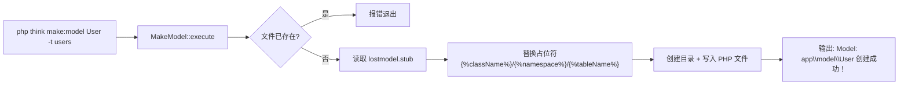

# make:model —— LostSky 项目模型生成命令

一行命令生成统一规范的模型文件，彻底告别复制粘贴 `Teams.php` 再改类名、改表名的手工活。

---

## 快速开始

生成文件路径：
- **命令类** `app/command/MakeModel.php`
- **模板存根** `app/command/stubs/lostmodel.stub`
- **注册配置** `config/console.php` 中的 `commands` 数组

使用前确认配置已注册完成，然后执行：

```bash
# 基础用法：类名自动识别表名
php think make:model User

# 指定数据表
php think make:model User --table users

# 简写
php think make:model User -t users
```

---

## 选项说明

| 选项 | 简写 | 类型 | 必填 | 说明 |
|------|------|------|------|------|
| `name` | — | Argument | 是 | 模型类名，如 `User`。支持 `module@Name` 语法（如 `admin@Log`） |
| `--table` | `-t` | Option | 否 | 绑定的数据表名，不传则留空让 ORM 依类名自动推断 |
| `--module` | `-m` | Option | 否 | 预留参数，暂未在生成逻辑中使用 |

---

## 用法示例

```bash
# 1) 最简写法——不传表名
php think make:model UserProfile
# → app/model/UserProfile.php，$name = ''，ORM 自动映射 user_profile 表

# 2) 指定表名
php think make:model User -t users
# → app/model/User.php，$name = 'users'

# 3) admin 模块下创建（自动放入 app/admin/model/）
php think make:model admin@Log -t admin_logs
# → app/admin/model/Log.php，namespace app\admin\model，$name = 'admin_logs'

# 4) 如果文件已存在，不会覆盖
php think make:model User -t users   # 第二次执行
# → [error] Model: app\model\User 已存在！
```

---

## 生成的模型结构

命名规范：统一继承 `app\model\Base`，自带以下能力：

| 基类能力 | 来源 | 说明 |
|----------|------|------|
| 自动时间戳 | `Base::$autoWriteTimestamp = true` | 写入时自动维护 `create_time` / `update_time` |
| 软删除 | `SoftDelete` trait，`deleteTime = 'delete_time'` | 调用 `delete()` 只更新 `delete_time`，不物理删除 |
| 隐藏字段 | `Base::$hidden` | 可配置需要从 JSON 中隐藏的字段 |

示例 —— `php think make:model User -t users` 生成：

```php
<?php
declare (strict_types = 1);

namespace app\model;

use app\model\Base;

/**
 * User 模型
 * @mixin \think\Model
 */
class User extends Base
{
    /**
     * 绑定数据表（为空则自动识别）
     * @var string
     */
    protected $name = 'users';

    /**
     * 字段类型转换
     * @var array
     */
    protected $type = [
    ];

    /**
     * JSON 字段
     * @var array
     */
    protected $json = [];
}
```

拿到模型后，只需填充 `$type`（整型/布尔/时间戳等）与 `$json` 两个数组即可，剩余的增删改查全部由 ThinkPHP ORM 提供。

---

## 手册速查

| 想做什么 | 对应属性 | 示例 |
|----------|----------|------|
| 字段类型转换 | `$type` | `'user_id' => 'integer'` |
| JSON 自动序列化 | `$json` | `['extra_info']` |
| 追加访问器 | `$append` | `['full_name']` |
| 关联查询 | 添加关联方法 | `hasOne`, `hasMany`, `belongsTo` |
| 修改器 | `setXxxAttr` | `setPasswordAttr` 自动哈希 |
| 获取器 | `getXxxAttr` | `getStatusTextAttr` 枚举转中文 |

---

## 工作原理



### 占位符映射

| 占位符 | 替换值来源 | 示例 |
|--------|-----------|------|
| `` | 类名部分 | `User` |
| `` | 自动拼接的命名空间 | `app\model` |
| `` | 应用命名空间（`$this->app->getNamespace()`） | `app` |
| `` | `--table` 选项，不传留空 | `users` |

---

## 自定义模板

如果需要调整生成模型的结构，直接编辑 `app/command/stubs/lostmodel.stub` 即可。下次执行命令时，新生成的文件会自动应用修改。

---

## FAQ

**Q: 和 ThinkPHP 自带的 `make:model` 有什么区别？**  
A: 本项目已在 `config/console.php` 中用自定义 `make:model` 覆盖了 ThinkPHP 原生命令，生成的是继承项目 `Base` 的完整骨架，已包含 `$name`、`$type`、`$json` 声明和中文注释，一步到位。

**Q: 不传 `--table` 会怎样？**  
A: `$name` 保持空字符串，ThinkPHP ORM 会根据类名自动推导表名（例如 `UserProfile` → `user_profile`），这恰好是大多数场景的正确行为。

**Q: 如何删除一个已生成的模型？**  
A: 目前命令不提供删除功能，手动删除 `.php` 文件即可。若想删除后重新生成，直接执行相同命令。
